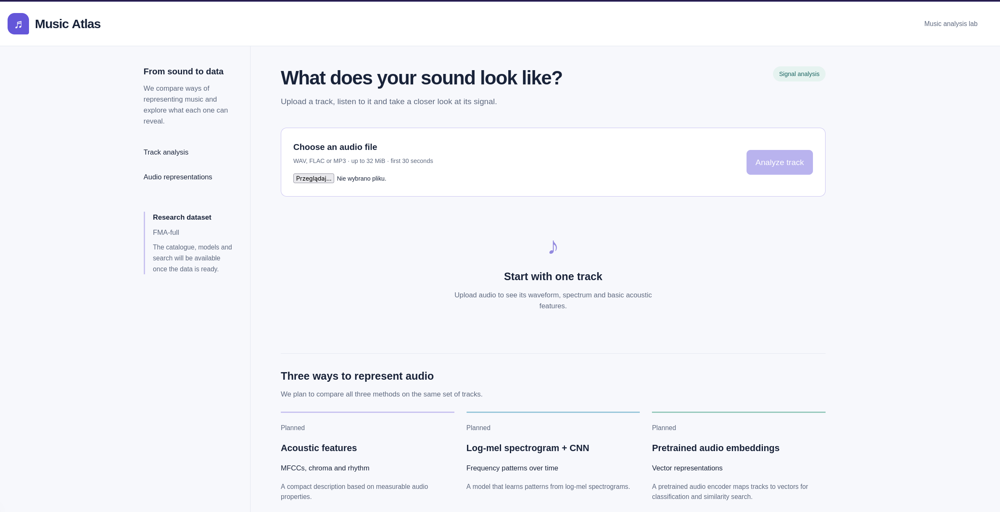

# Music Atlas

Music Atlas explores how different representations of audio capture musical structure.
The project combines genre classification, exploratory analysis and similarity search
to study what can be learned from a large collection of music recordings. Its central
question is how the choice of representation changes the patterns we discover, the
genres we recognise and the tracks we consider similar.

## Research approach

We compare three approaches on a shared dataset and evaluation protocol:

| Representation | Classification | Analysis and retrieval |
|---|---|---|
| Acoustic features: MFCCs, chroma, rhythm and spectral statistics | Logistic regression and a tree-based model | Feature interpretation, clustering and nearest neighbours |
| Log-mel spectrograms | A compact CNN trained from scratch | Learned features and similarities between recordings |
| Embeddings from a pretrained audio encoder | A linear classification head | Embedding maps, clustering and sounds-like search |

The comparison covers predictive quality, retrieval relevance and computational cost.
Listening examples complement numerical results, particularly where genre labels and
perceived similarity disagree. Exploratory views connect these results to the underlying
audio, making preprocessing choices and dataset limitations part of the analysis.

The three branches provide different kinds of evidence. Hand-engineered acoustic features
such as MFCCs, chroma, rhythm and spectral statistics give a compact, interpretable baseline.
A CNN learns patterns from log-mel spectrograms, which preserve how frequency content changes
over time. A frozen pretrained audio encoder turns each window into an embedding vector; a
lightweight linear classifier can test genre information in that space, while nearest-neighbour
search can compare tracks by their vectors. Freezing the encoder avoids a large fine-tuning run
and lets us measure encoder extraction separately from classifier training. These are planned
experiments, not completed model results.

All branches use one artist-disjoint train/validation/test split and deterministic audio windows.
Classification will be compared with macro-F1, micro-F1 and mean average precision (mAP).
Retrieval will use precision@10 and nDCG@10, alongside listening examples and resource costs.
The held-out test split is reserved for final evaluation; artist and duplicate groups stay within
one split to reduce leakage.

## Data and computation

The project uses [FMA-full](https://github.com/mdeff/fma), containing 106,574 full-length
tracks organised in a hierarchy of 161 genres. The complete validated catalogue is
intended for exploration and retrieval; supervised experiments use the recordings and
labels supported by the agreed classification protocol. Audio is processed in windows,
with representations aggregated at track level.

Large-scale processing and training run on [WCSS](https://man.e-science.pl/pl/kdm/bem2),
using an allocation of **4,000 CPU hours, 300 GPU hours and 2 TB of storage**. Local
development uses uv and a small reproducible sample. The same code runs on WCSS with
the full profile, while datasets, caches and experiment artifacts reside on project
storage outside the Git repository. MLflow records configurations, metrics and artifacts
so that results can be compared and reproduced.

### Local MLflow

MLflow is the planned experiment tracker for run parameters, metrics and files such as plots,
reports and exported vectors. Install its optional dependencies and start a local server:

```bash
uv sync --locked --extra research --extra tracking
mkdir -p outputs artifacts/mlflow
uv run mlflow server --host 127.0.0.1 --port 5000 \
  --backend-store-uri sqlite:///outputs/mlflow.db \
  --default-artifact-root ./artifacts/mlflow
```

Open http://127.0.0.1:5000 to view runs. The SQLite database stores run metadata; files are
stored under `artifacts/mlflow/`. In the shell that will run experiments, set
`MLFLOW_TRACKING_URI=http://127.0.0.1:5000` to point the client at this server. Keep it bound to
localhost for local development. The experiment runner that logs Music Atlas jobs to MLflow is
planned but is not yet implemented.

For WCSS, the intended layout is to put the tracking database and MLflow artifact directory on
persistent project storage, alongside the other `ATLAS_*` directories, so they survive jobs and
are available from the cluster. The exact remote server setup and how local machines will reach
it (for example, a tunnel) are still undecided. MLflow can expose run artifacts for download once
that access path is configured; the final application bundle is a separate export and should not
depend on a live MLflow server. See the [development guide](docs/DEVELOPMENT.md) before setting up
tracking on WCSS.

## Application

A Next.js interface backed by FastAPI will bring together dataset exploration, audio
inspection, genre predictions and nearest-neighbour search. Users will be able to
compare representations for the same recording and listen to retrieved examples.
The final application will run through Docker Compose with exported models and indexes,
independently of the training environment.

The current implementation supports audio upload, playback, waveform and power-spectrum
plots, and basic acoustic measurements. Classification and retrieval are under development.

## Development

Python 3.12, [uv](https://docs.astral.sh/uv/) and Node.js 22+ are required.

```bash
uv sync --locked
uv run uvicorn music_atlas.api:app --reload
```

In a second terminal:

```bash
cd web
npm ci
npm run dev
```

Open http://localhost:3000. API documentation is available at http://localhost:8000/docs.

- [Development guide](docs/DEVELOPMENT.md): repository layout, WCSS, MLflow and Docker.
- [Experimental protocol](docs/EXPERIMENTS.md): data splits, representations and evaluation.
- [Current tasks](tasks/README.md)
