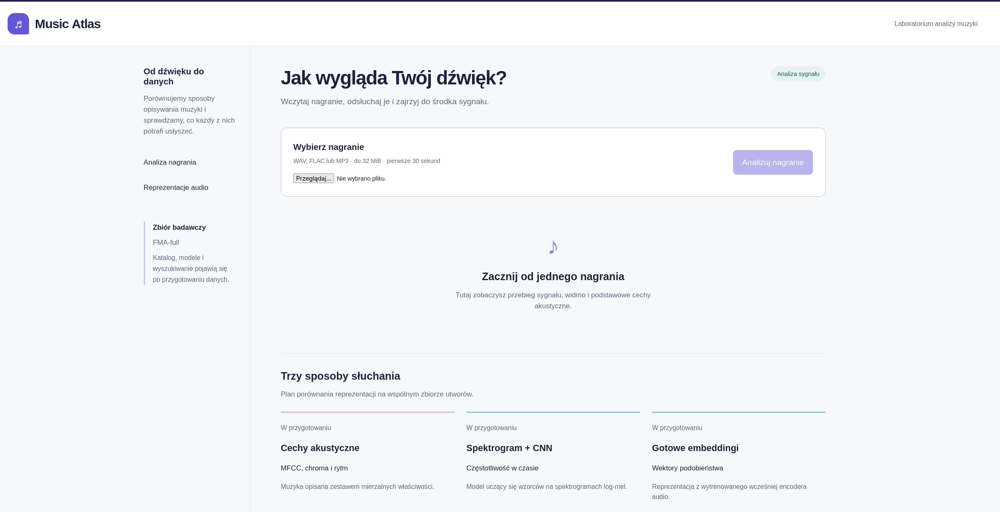

# Music Atlas

Music Atlas explores how different representations of audio capture musical structure.
The project combines genre classification, exploratory analysis and similarity search
to study what can be learned from a large collection of music recordings. Its central
question is how the choice of representation changes the patterns we discover, the
genres we recognise and the tracks we consider similar.

**Start here:** [`notebooks/01-data-exploration.ipynb`](notebooks/01-data-exploration.ipynb)
introduces the data, what is wrong with it, how we clean it and how we split it.

## Research approach

We compare three approaches on a shared dataset and evaluation protocol:

| Representation | Classification | Analysis and retrieval |
|---|---|---|
| Acoustic features: MFCCs, chroma, rhythm and spectral statistics | Logistic regression and a tree-based model | Feature interpretation, clustering and nearest neighbours |
| Log-mel spectrograms | A compact CNN trained from scratch | Learned features and similarities between recordings |
| Embeddings from a frozen pretrained audio encoder | A linear classification head | Embedding maps, clustering and sounds-like search |

All three use one artist-disjoint train/validation/test split and the same deterministic audio
windows. Classification is compared with macro-F1, micro-F1 and mAP; retrieval with
precision@10 and nDCG@10, alongside listening examples and computational cost. These are
planned experiments, not completed model results.

## Data and computation

The project uses [FMA-full](https://github.com/mdeff/fma): 106,574 full-length tracks in a
hierarchy of 163 genres under 16 top-level genres. An audio audit excludes the 0.3% of files
that are broken, and the primary benchmark `fma-cap10-v1` limits any one artist to 10% of a
genre's validation or test tracks. The [experimental protocol](docs/EXPERIMENTS.md) defines
the rules and formats.

Processing and training run on [WCSS](https://man.e-science.pl/pl/kdm/bem2) with
**4,000 CPU hours, 300 GPU hours and 2 TB of storage**. Local development uses uv and a
128-track sample; the same code runs on WCSS with the full profile. Data, caches and artifacts
live outside Git, and MLflow records configurations, metrics and artifacts of each run.

## Application

A Next.js interface backed by FastAPI will bring together dataset exploration, audio
inspection, genre predictions and nearest-neighbour search, comparing representations for
the same recording. It currently supports audio upload, playback, waveform and power-spectrum
plots and basic acoustic measurements. The final application runs through Docker Compose with
exported models and indexes.

## Development

Python 3.12, [uv](https://docs.astral.sh/uv/) and Node.js 22+ are required.

```bash
uv sync --locked
uv run uvicorn music_atlas.api:app --reload
```

In a second terminal:

```bash
cd web
npm ci
npm run dev
```

Open http://localhost:3000; API documentation is at http://localhost:8000/docs.

### Quick sample first, full data second

Develop every data or model step on the 128-track quick sample, then run it on the full dataset
on WCSS. The sample is a fixed set of training tracks from the primary benchmark (about 1 GiB of
MP3s); it stays on WCSS project storage, not in Git, and each of us copies it once:

```bash
mkdir -p data/samples
rsync -a YOUR_LOGIN@ui.wcss.pl:/lustre/pd03/hpc-piotrczech-1792095018/music-atlas/data/samples/fma-cap10-v1 data/samples/
uv run --extra research atlas quick-sample   # checks that all 128 tracks load
```

1. **Quick, locally:** run the step with the `quick` profile (one centred window per track) on
   the sample until it works end to end and its tests pass.
2. **Quick, on WCSS:** run the same command as a short job to check paths, the environment and
   throughput; use the measured time to size the full job.
3. **Full, on WCSS:** run the `full` profile on `ready/<version>/` from the shards, reading
   shard by shard.

### Tracking runs

A step started with `--track` is recorded in MLflow: Git revision, profile, the dataset it read
(version, manifest hash, track and genre counts), timing and metrics. Its files go to a run directory with a `run.json`
copy of the record, so results stay readable without MLflow. Runs land in `outputs/mlruns`
unless `MLFLOW_TRACKING_URI` points elsewhere; no server has to run while they are recorded.

```bash
uv sync --locked --extra research --extra tracking
uv run atlas quick-sample --track
scripts/mlflow-ui.sh   # http://127.0.0.1:5000; MLFLOW_PORT and MLFLOW_TRACKING_URI override it
scripts/mlflow-ui.sh --wcss   # copy the runs logged by WCSS jobs from PD first
```

### Commands

The data commands need `uv sync --locked --extra research` and run on WCSS as jobs through
`scripts/slurm/*.sbatch`, which pass extra arguments on.

| Command | What it does |
|---|---|
| `atlas doctor --profile quick` | Show the resolved `ATLAS_*` paths and a profile |
| `atlas demo`, `atlas analyze FILE` | Write a synthetic test tone; analyse up to 30 s of an audio file |
| `atlas fma-download [--probe] [--limit N]` | Stream FMA-full into verified tar shards and write the inventory |
| `atlas fma-audit [--limit N]` | Decode every track and write the audio audit |
| `atlas fma-split --audit FILE [--max-artist-share 0.1] [--strategy rare-support] [--publish]` | Build a versioned train/validation/test split; `--publish` makes it the shared manifest |
| `atlas quick-sample [VERSION] [--track]` | Build the 128-track quick sample of the primary benchmark, or reload it from `audio.tar` and time the loader; `--track` records the run in MLflow |
| `atlas fma-record-filter VERSION REPRESENTATION RUN_ID exclusions.csv` | Record the tracks a representation run could not use |
| `uv run ruff check .`, `uv run pytest` | Lint and test; `npm run typecheck` and `npm run build` in `web/` |

- [Development guide](docs/DEVELOPMENT.md): layout, WCSS, data pipeline, notebooks, MLflow and Docker
- [Experimental protocol](docs/EXPERIMENTS.md): data, splits, metrics and representations
- [Tasks](tasks/README.md)
